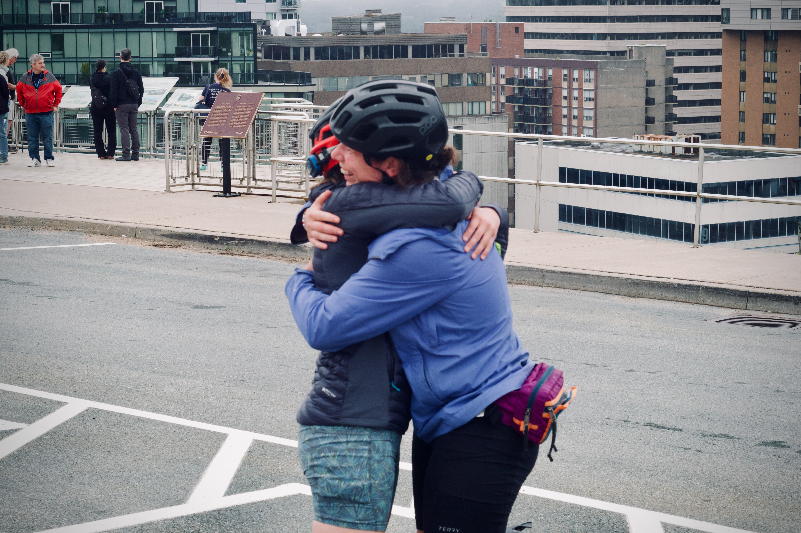
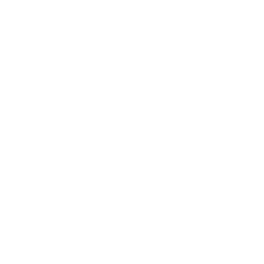
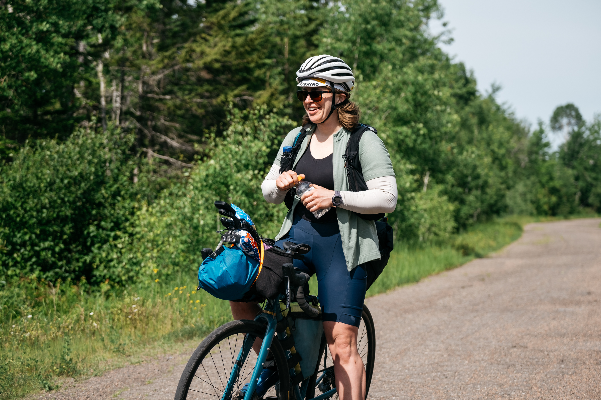

::: {.race-header .column-screen}

<h1>People behind the pedals</h1>

:::

Every great adventure starts with an idea, but it takes a few good people to bring it to life. From dreaming up routes and turning wild ideas into real rides, to the local businesses, partners, and supporters who help make it all happen, there's a whole lot of people behind the Long Way Cycling Series.

These are the people who keep the wheels turning, the adventures growing, and give us plenty of reasons to keep taking the long way around.

::: {.supporter-founder}
::: {.supporter-founder-text}
## The Founder: Ashleigh Myles
Halifax-based endurance cyclist Ashleigh Myles helped turn a big ride across Nova Scotia into something much bigger.

The founder of The Long Way Cycling Series, Ashleigh has spent years encouraging others to discover just how far two wheels can take them.

She's also pretty good at taking on a challenge herself. In 2025, she set a Guinness World Record, cycling 22,412 km from Alaska to Argentina in just 118 days.

But closer to home, it's about getting more people out riding, exploring new places, and finding their own adventures.
:::

:::

::: {.blue-section .supporter-support}
## You Can Support Us

We are always looking for new supporters to back our events and help the series grow.

Sponsorship, donated products or services, event support and fresh ideas are all welcome. If your business or organisation would like to get involved, contact us and let's find the right way to work together.

**Send us a message on Instagram or Facebook.**

::: {.supporter-links}
[Instagram](https://www.instagram.com/thelongwayseries_ns/){.supporter-link} [Facebook](https://www.facebook.com/tip2tipns/){.supporter-link}
:::
:::

::: {.past-supporters}
## Past Supporters

Thank you to the businesses and organisations that have supported our events along the way. We appreciate the part you've played in our riding community.

::: {.past-supporter-grid}
- [Priority First Aid](https://priorityfirstaid.ca/) — First aid training courses in Nova Scotia.
- [Fluent Frameworks](https://www.fluentframeworks.com/) — Personality and expression through high-end custom steel bicycles.
- [Long Alley Bicycles](https://longalleybicycles.com/)
- [3 Mile](https://3mile.ca/) — Located at the 5K mark of the rail trail. An outpost for gear and fuel for riding and life outside in Nova Scotia.
- [Trailblazer Physiotherapy](https://www.trailblazerphysio.ca/)
- [Dartmouth Dodge](https://www.ddodge.com/)
- [Naak](https://www.naak.com/)
- [Locke's Sporting](https://www.lockessporting.com/) — 161 Water Street, Shelburne, Nova Scotia B0T 1W0.
:::
:::