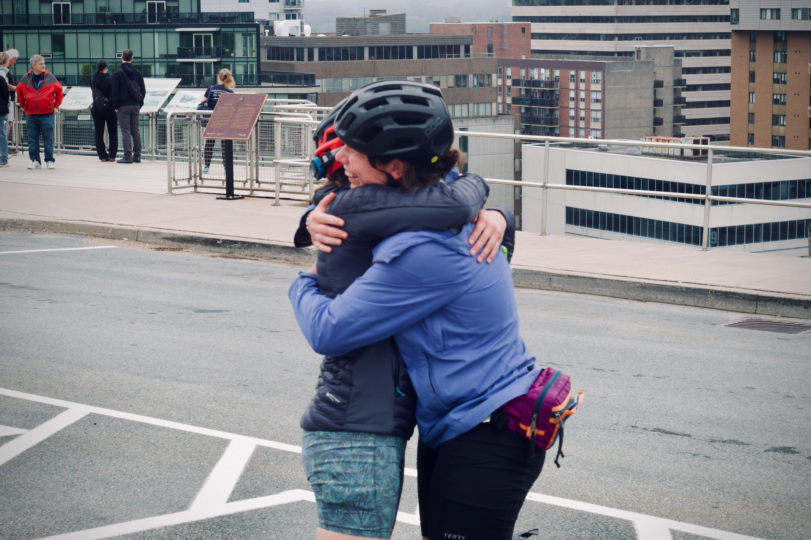

::: {.race-header .column-screen}

<h1>Supporters</h1>

:::

## Help Us Go the Long Way

**We're looking for new supporters to back our events.**

The Long Way Cycling Series brings riders together for self-supported
adventures across Nova Scotia and beyond. Behind those rides is a community
of people and businesses helping make them happen.

If your business or organisation would like to support our events, we'd love
to hear from you. Whether you're interested in sponsorship, contributing
products or services, or have another idea, get in touch and let's talk about
how we could work together.

**Send us a message on Instagram or Facebook:**

::: {.race-resources}
[Contact us on Instagram](https://www.instagram.com/thelongwayseries_ns/) [Contact us on Facebook](https://www.facebook.com/tip2tipns/)
:::

## Past Supporters

Thank you to the businesses and organisations that have supported our events
along the way. We appreciate the part you've played in our riding community.

- [Priority First Aid](https://priorityfirstaid.ca/) - First aid training courses in Nova Scotia.
- [Fluent Frameworks](https://www.fluentframeworks.com/) - Personality and expression through high-end custom steel bicycles.
- [Long Alley Bicycles](https://longalleybicycles.com/)
- [3 Mile](https://3mile.ca/) - Located at the 5K mark of the rail trail. An outpost for gear and fuel, from FKT attempts to eating outside, built for the Nova Scotia terrain.
- [Trailblazer Physiotherapy](https://www.trailblazerphysio.ca/)
- [Dartmouth Dodge](https://www.ddodge.com/)
- [Naak](https://www.naak.com/)
- [Locke's Sporting](https://www.lockessporting.com/) - 161 Water Street, Shelburne, Nova Scotia B0T 1W0.