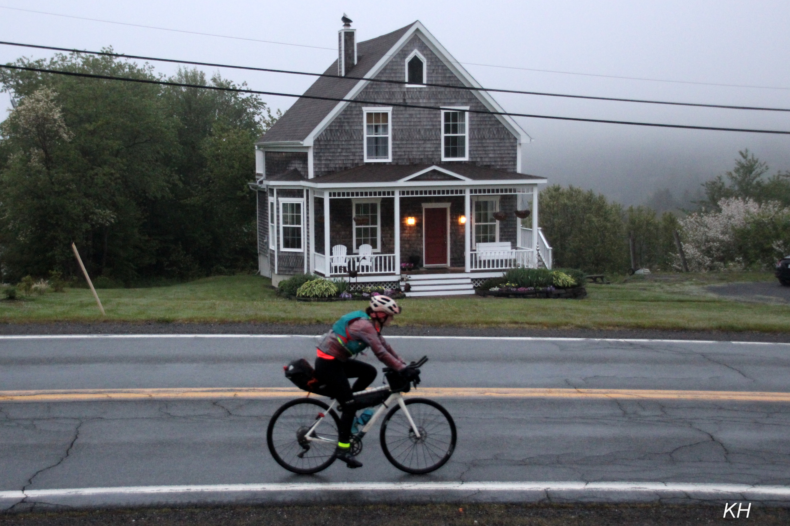
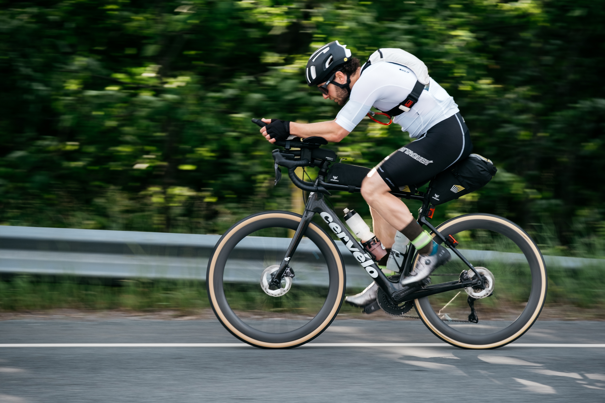

# LOCOmotion 600 Alumni

The riders who went LOCO. Explore results from past editions of LOCOmotion 600.

[Back to LOCOmotion 600](locomotion-600.qmd#past-editions)

**Browse by year:** [2026](#edition-2026) · [2025](#edition-2025) · [2024](#edition-2024) · [2023](#edition-2023) · [2022](#edition-2022)
***

## 2026 {#edition-2026}

::: {layout-ncol=2}
{fig-alt="Kajsa Holland-Goon, female winner of LOCOmotion 600 in 2026"}

{fig-alt="Stephen Paterson, male winner of LOCOmotion 600 in 2026"}
:::

### Solo

| Place | Rider | Recorded time | Status |
|:------|:------|:--------------|:-------|
| 1st | Stephen Paterson | 30 hrs 47 mins | Finished |
| 2nd | Vlad Roussakov | 35 hrs 36 mins | Finished |
| 3rd | Sam Caldwell | 35 hrs 49 mins | Finished |
| 4th | Nick O'Connor | 36 hrs 1 min | Finished |
| 5th | Alex MacLean | 37 hrs 2 mins | Finished |
| 6th | Gregory Simms | 38 hrs 20 mins | Finished |
| 7th | Mike Davis | 38 hrs 51 mins | Finished |
| 8th | Adam Humble | 40 hrs 29 mins | Finished |
| 9th | Kajsa Holland-Goon | 40 hrs 50 mins | Finished |
| 10th | Jamey Smith | 41 hrs 30 mins | Finished |
| 11th | Danielle Davenport | 45 hrs 5 mins | Finished |
| 12th | Rob Grandy | 45 hrs 9 mins | Finished |
| 13th | Derik Sauve | 45 hrs 23 mins | Finished |
| 14th | Vic Macdonald | 51 hrs 3 mins | Finished |
| 15th | Marcie Wall | 52 hrs 5 mins | Finished |
| 16th | Luis Cardoso | 52 hrs 25 mins | Finished |
| 17th | Greco Krinis | 52 hrs 36 mins | Finished |
| 18th | Bruce Webb | 52 hrs 48 mins | Finished |
| 19th | Michael Kiefte | 54 hrs 13 mins | Finished |
| 20th | Clay Sinclair | 55 hrs 22 mins | Finished |
| 21st | Gavin Urquhart | 55 hrs 34 mins | Finished |
| 22nd | Holly Foxall | 58 hrs 18 mins | Finished |
| 23rd | Jessie Dale | 58 hrs 18 mins | Finished |
| 24th | Simone Charron | 63 hrs 22 mins | Finished |
| — | Bailey Vernon | — | DNF |
| — | Josh Daniels | — | DNF |
| — | John Archibald | — | DNF |
| — | Cameron Moffatt | — | DNF |
| — | Lee Veinotte | — | DNF |
| — | Pascale Ouellette | — | DNF |
| — | Alex Whitworth | — | DNF |
| — | Carlin Reid | — | DNF |
| — | Sam Meyboom | — | DNF |
| — | Rafi Mamdani | — | DNF |
| — | Ryan Mitchell | — | DSQ |
| — | Catherine Connell | — | DNF |
| — | Colin Mitchinson | — | DNF |

### Pairs

| Place | Team | Recorded time | Status |
|:------|:-----|:--------------|:-------|
| 1st | Joey & Grant | 32 hrs 59 mins | Finished |
| 2nd | Slowcomotion | 59 hrs 43 mins | Finished |
| — | Robbed of Power | — | DNF |

***

## 2025 {#edition-2025}

[View the race tracking map](https://www.followmychallenge.com/live/locomotion25/)

### Solo

| Place | Rider | Recorded time | Status |
|:------|:------|:--------------|:-------|
| 1st | Stephen Paterson | 29 hrs 2 mins | Finished |
| 2nd | John Archibald | 29 hrs 15 mins | Finished |
| 3rd | Alysa Orellana | 30 hrs 5 mins | Finished |
| 4th | Alex MacLean | 33 hrs 31 mins | Finished |
| 5th | Rachyl MacPhail | 37 hrs 56 mins | Finished |
| 6th | Henry Penn | 39 hrs 3 mins | Finished |
| 7th | Sean Balfour | 39 hrs 9 mins | Finished |
| 8th | Luis Cardoso | 39 hrs 57 mins | Finished |
| 9th | Nick Purdie | 42 hrs 44 mins | Finished |
| 10th | Ashleigh Myles | 44 hrs 11 mins | Finished |
| 11th | Nik Pilsworth | 55 hrs 35 mins | Finished |
| 12th | Cameron Moffatt | 60 hrs 4 mins | Finished |
| 13th | Jessie Dale | 60 hrs 4 mins | Finished |
| 14th | Holly Foxall | 60 hrs 5 mins | Finished |
| 15th | Lee Veinotte | 60 hrs 5 mins | Finished |
| — | Timo Bschaden | — | DNF |
| — | Jackson Bonn | — | DNF |
| — | Danielle Davenport | — | DNF |
| — | Vic Macdonald | — | DNF |
| — | Aaron MacRitchie | — | DNF |
| — | Christian Hansen | — | DNF |
| — | Jesslyn Fowlie | — | DNF |
| — | Nicholas Hussey | — | DNF |
| — | Aryn Sanojca | — | DNF |

### Pairs

| Place | Team | Recorded time | Status |
|:------|:-----|:--------------|:-------|
| 1st | Herding Badly | 32 hrs 20 mins | Finished |
| 2nd | Underprepared | 39 hrs 48 mins | Finished |
| — | Triple Bogey | — | DNF |

***

## 2024 {#edition-2024}

[View the race tracking map](https://www.followmychallenge.com/live/locomotion24)

### Solo

| Place | Rider | Recorded time | Status |
|:------|:------|:--------------|:-------|
| 1st | Alex Maclean (M) | 28 hrs 22 mins | Finished |
| 2nd | Jamie Morrison (M) | 32 hrs 39 mins | Finished |
| 3rd | Craig Michie (M) | 33 hrs 22 mins | Finished |
| 4th | Josh Coyle (M) | 35 hrs 35 mins | Finished |
| 5th | Luis Cardoso (M) | 37 hrs 39 mins | Finished |
| 6th | Alysa Orellana-Makila (F) | 38 hrs 3 mins | Finished |
| 7th | Ashleigh Myles (F) | 38 hrs 26 mins | Finished |
| 8th | Jeshua Becker (M) | 38 hrs 27 mins | Finished |
| 9th | Aryn Sanojca (F) | 57 hrs 23 mins | Finished |
| 10th | Jessie Dale (F) | 58 hrs 8 mins | Finished |
| — | Ian Whitcomb (M) | — | DNF |
| — | Alex Whitworth (M) | — | DNF |
| — | Vicki Robertson (F) | — | DNF |
| — | Matthew Rockwell (M) | — | DNF |
| — | Lee Venoitte (M) | — | DNF |
| — | Ryan Dooley (M) | — | DNS |

### Pairs

| Place | Team | Recorded time | Status |
|:------|:-----|:--------------|:-------|
| 1st | Lunenbikers | 37 hrs 45 mins | Finished |
| — | The Slow Spokes | 42 hrs 18 mins | DNF |
| — | All Bananas No Brakes | 58 hrs 17 mins | DNF |
| — | Stoucher | — | DNF |
| — | TWD | — | DNF |

***

## 2023 {#edition-2023}

[View the race tracking map](https://www.followmychallenge.com/live/locomotion/)

### Solo

| Place | Rider | Recorded time | Status |
|:------|:------|:--------------|:-------|
| 1st | Matthieu Fraser | 32 hrs 26 mins | Finished |
| 2nd | Cliff Gaetz | 36 hrs 8 mins | Finished |
| 3rd | Lee Veinotte | 41 hrs 44 mins | Finished |
| 4th | Ron Cleroux | 41 hrs 58 mins | Finished |
| 5th | Patrick Rogers | 42 hrs 46 mins | Finished |
| 6th | Mark Jewell | 26 hrs 58 mins | Finished |

Mark Jewell's supplied time is shorter than the times listed ahead of him. The recorded time and placing have been retained as supplied and need confirmation.

***

## 2022 {#edition-2022}

[View the race tracking map](https://www.followmychallenge.com/live/locomotion600/)

### Solo

| Place | Rider | Recorded time | Status |
|:------|:------|:--------------|:-------|
| 1st | James Macneil | 28 hrs 28 mins | Finished |
| 2nd | Jacob Goulden | 32 hrs 41 mins | Finished |
| 3rd | Dylan Porter | 40 hrs 31 mins | Finished |
| 4th | Alex Whitworth | 57 hrs 45 mins | Finished |
| — | Derik Sauve | — | DNF |
| — | Thomas Frellick | — | DNF |
| — | Jack Kelly | — | DNF |
| — | Ron Cleroux | — | DNF |

### Pairs

| Place | Team | Recorded time | Status |
|:------|:-----|:--------------|:-------|
| 1st | Slow Speed Wizards p/b Cyclesmith | 36 hrs 2 mins | Finished |
