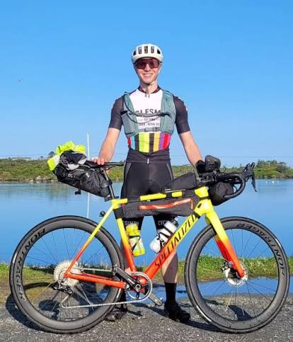

# Tip 2 Tip Alumni

The riders who took the long way across Nova Scotia. Explore results from past editions of the original Tip 2 Tip.

[Back to the race](tip2tiprace.qmd#past-editions)

**Browse by year:** [2025](#edition-2025) · [2024](#edition-2024) · [2023](#edition-2023) · [2022](#edition-2022)

***

## 2025 — Oops! All the Tips Edition {#edition-2025}

[View the race tracker](https://www.followmychallenge.com/live/tip2tipns25/)

::: {layout-ncol=2}
{fig-alt="Tip 2 Tip 2025 — Oops! All the Tips Edition"}

{fig-alt="Isaac at Tip 2 Tip"}
:::

| Place | Rider | Finish time | Status |
|:------|:------|:------------|:-------|
| 1st | Isaac Passavoy | 83 hrs 39 mins | Finished |
| 2nd | Ethan Malech | 84 hrs 15 mins | Finished |
| 3rd | Lee Venoitte | 99 hrs 16 mins | Finished |
| 4th | Sean Therien | 102 hrs 53 mins | Finished |
| 5th | Luis Cardoso | 123 hrs 7 mins | Finished |
| 6th | VIc MacDonald | 123 hrs 12 mins | Finished |
| — | Matthew Gillis | — | DNF |

***

## 2024 {#edition-2024}

[View the race tracker](https://www.followmychallenge.com/live/tip2tipns24/)

### Solo

| Place | Rider | Finish time | Status |
|:------|:------|:------------|:-------|
| 1st | Kieran Sharpe | 46 hrs 34 mins | Finished |
| 2nd | John Archibald | 53 hrs 19 mins | Finished |
| 3rd | Matthieu Fraser | 56 hrs 10 mins | Finished |
| 4th | Ethan Malech | 65 hrs 10 mins | Finished |
| 5th | Ashleigh Myles | 66 hrs 9 mins | Finished |
| 6th | Alysa Orellana | 66 hrs 10 mins | Finished |
| 7th | Devin Delaney | 67 hrs 10 mins | Finished |
| 8th | Timo Bschaden | 75 hrs 28 mins | Finished |
| 9th | Gaelle Coullon | 77 hrs 42 mins | Finished |
| 10th | Luis Cardoso | 81 hrs 18 mins | Finished |
| 11th | Jessy Leger | 81 hrs 40 mins | Finished |
| 12th | Kerry Coolen | 85 hrs 56 mins | Finished |
| 13th | Alex Whitworth | 103 hrs 24 mins | Finished |
| 14th | Jessica Needham | 104 hrs 28 mins | Finished |
| — | Hannah Marais | — | DNF |
| — | Alex Maclean | — | DNF |
| — | Jacob Taljaard | — | DNF |
| — | Alan Power | — | DNF |
| — | Ron Cleroux | — | DNF |

### Pairs

| Place | Team | Finish time | Status |
|:------|:-----|:------------|:-------|
| — | All Out | — | DSQ |

***

## 2023 {#edition-2023}

[View the race tracker](https://www.followmychallenge.com/live/tip2tipns23/)

| Place | Rider | Finish time | Status |
|:------|:------|:------------|:-------|
| 1st | Jamie Morrison | 75 hrs 36 mins | Finished |
| 2nd | Stewart Riggs | 78 hrs 1 min | Finished |
| 3rd | Cliff Gaetz | 83 hrs 2 mins | Finished |
| 4th | Matt Bawtinheimer | 98 hrs 56 mins | Finished |
| 5th | Joshua Coyle | 105 hrs 45 mins | Finished |
| 6th | Alex Whitworth | 106 hrs 45 mins | Finished|

***

## 2022 {#edition-2022}

[View the race tracker](https://www.followmychallenge.com/live/tip2tipns22/)

| Place | Rider | Finish time | Status |
|:------|:------|:------------|:-------|
| 1st | Kieran Sharpe | 59 hrs 13 mins | Finished |
| 2nd | Matthieu Fraser | 63 hrs 37 mins | Finished |
| 3rd | Peter MacGregor | 64 hrs 15 mins | Finished |
| 4th | Ethan Copp | 73 hrs 40 mins | Finished |
| 5th | Mark Jewell | 85 hrs 33 mins | Finished |
| 6th | Sam Caldwell | 99 hrs 36 mins | Finished |
| 7th | Dylan Porter | 108 hrs 49 mins | Finished |
| — | Derik Sauve | — | DNF |
| — | John Archibald | — | DNF |
| — | Lee Veinotte | — | DNF |
