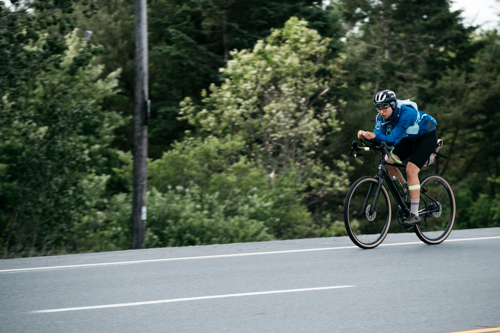
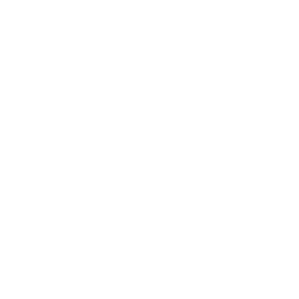
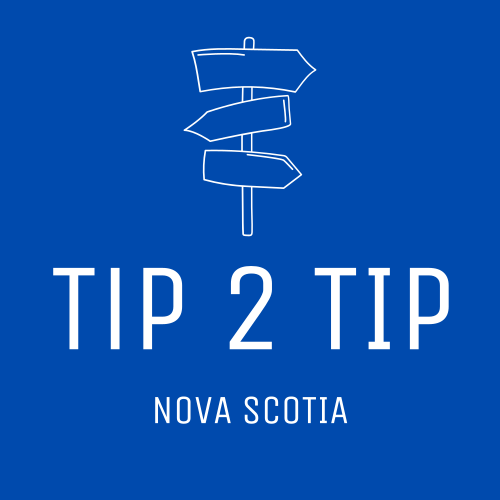
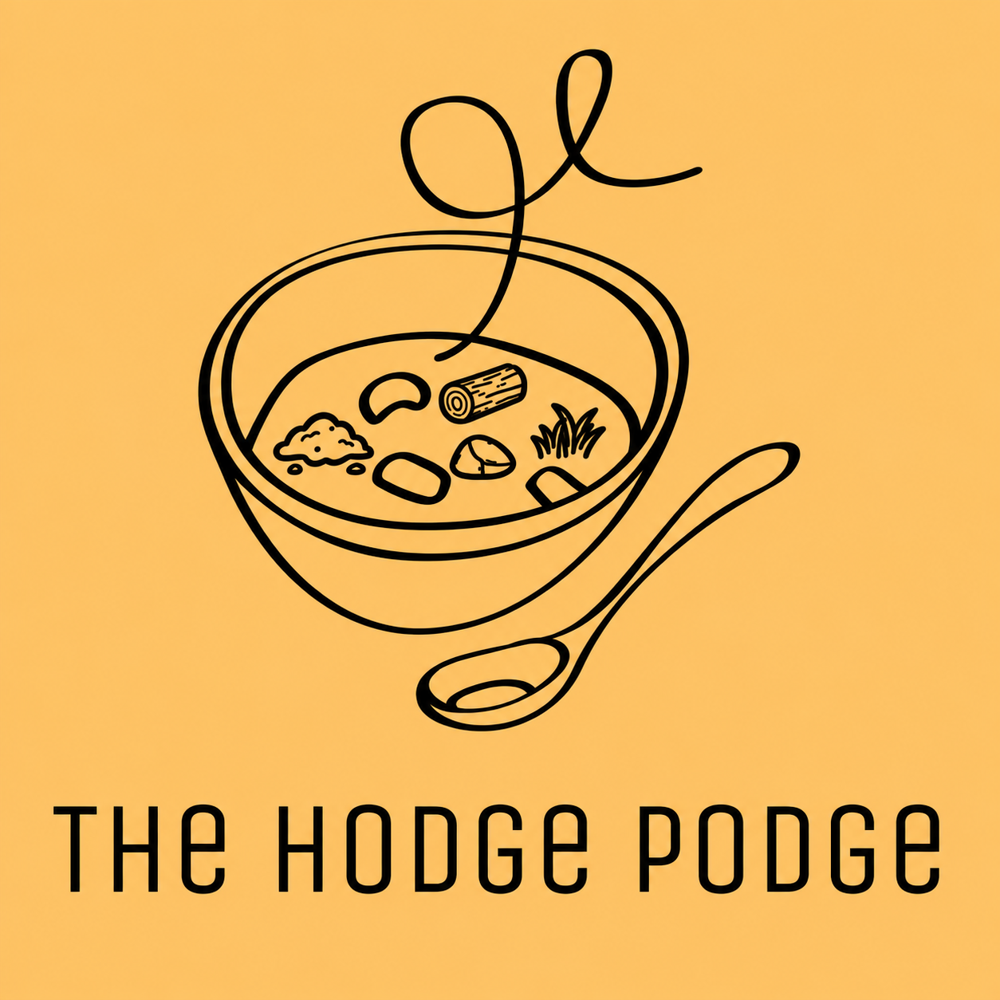
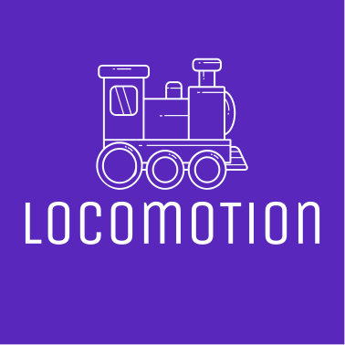
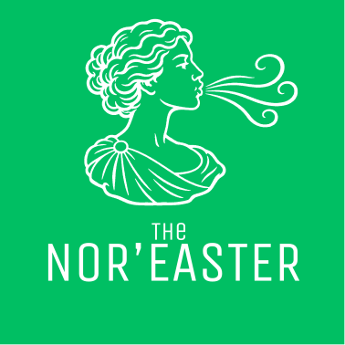
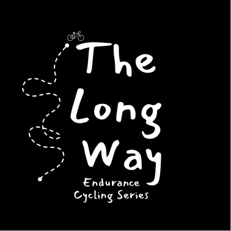

::: {.race-header}


<div class="about-hero-content">

<p class="about-tagline"></p>
</div>

:::

The Long Way Cycling Series is Nova Scotia’s homegrown long-distance cycling series, born out of a slightly unhinged idea back in 2020. When the pandemic had us in lockdown, international races were off the calendar and ultra-endurance cycling events in Atlantic Canada were pretty much nonexistent, three cyclists, soon to become friends, decided to make their own adventure: ride across Nova Scotia, Tip 2 Tip!

From Hawk Beach to Meat Cove, the three covered roughly 750 km from one end of the province to the other, with plenty of hills, headwinds, and questionable life choices along the way. What started as one big ride got them thinking: if we were looking for this kind of adventure close to home, surely other people were too?

And so The Long Way Cycling Series was born. What began with Tip 2 Tip has grown into a series of self-supported endurance cycling events that take riders across Nova Scotia and beyond. Different distances, different routes, but the idea remains the same: <strong> get on your bike, go somewhere, and see what happens along the way </strong>


```{=html}
<div class="race-cards">

  <a href="tip2tiprace.qmd" class="race-card">
    <div class="race-logo">
      
    </div>
    <div class="race-card-content">
      <div class="race-card-label">THE ORIGINAL</div>
      <h2>Tip 2 Tip Nova Scotia</h2>
      <p>Choose your route. Hit the checkpoints· Self-supported</p>
      <span class="race-card-link">Explore the original →</span>
    </div>
  </a>

  <a href="tip2tipgravel.qmd" class="race-card">
    <div class="race-logo">
      
    </div>
    <div class="race-card-content">
      <div class="race-card-label">THE GRAVEL EDITION</div>
      <h2>The Hodge Podge</h2>
      <p>Tip 2 Tip, but it's gravel. Coming 2027.</p>
      <span class="race-card-link">Explore the race →</span>
    </div>
  </a>

  <a href="locomotion-600.qmd" class="race-card">
    <div class="race-logo">
      
    </div>
    <div class="race-card-content">
      <div class="race-card-label">THE ENTRY</div>
      <h2>The LOCOmotion</h2>
      <p>~650 km · Fixed route · Self-supported</p>
      <p class="race-card-teaser">
        A little more LOCO is coming in 2027...
      </p>
      <span class="race-card-link">Explore the ride →</span>
    </div>
  </a>

  <a href="noreaster-race.qmd" class="race-card race-card-secret">
    <div class="race-logo race-logo-secret">
      
    </div>
    <div class="race-card-content">
      <div class="race-card-label">COMING 2028</div>
      <h2>The Nor'Easter</h2>
      <p>Montreal → Halifax · New challenge in development</p>
      <span class="race-card-link">See the early details →</span>
    </div>
  </a>
</div>
```
```{=html}
<section class="follow-us" aria-labelledby="follow-us-heading">
  
  <div class="follow-us-content">
    <h2 id="follow-us-heading">FOLLOW US</h2>
    <div class="follow-us-links">
    <a href="https://www.facebook.com/tip2tipns/">
      <i class="bi bi-facebook" aria-hidden="true"></i>
      <span>Facebook</span>
    </a>
    <a href="https://www.instagram.com/thelongwayseries_ns/">
      <i class="bi bi-instagram" aria-hidden="true"></i>
      <span>Instagram</span>
    </a>
    </div>
  </div>
</section>
```

```{=html}
<section class="land-acknowledgement" aria-labelledby="land-acknowledgement-heading">
  <span class="land-acknowledgement-mark" aria-hidden="true"></span>
  <div class="land-acknowledgement-content">
    <p>The Long Way Cycling Series takes place in Mi'kma'ki, the ancestral and unceded territory of the Mi'kmaq People.</p>
    <p>As we ride through the forests, coastlines, and communities of Nova Scotia, we acknowledge the Mi'kmaq as the past, present, and future caretakers of these lands and waters.</p>
    <p>We are grateful for the opportunity to explore these places and recognize our shared responsibility to respect and care for the land we travel through.</p>
    <p class="land-acknowledgement-treaty"><strong>We are all Treaty People.</strong></p>
  </div>
</section>
```