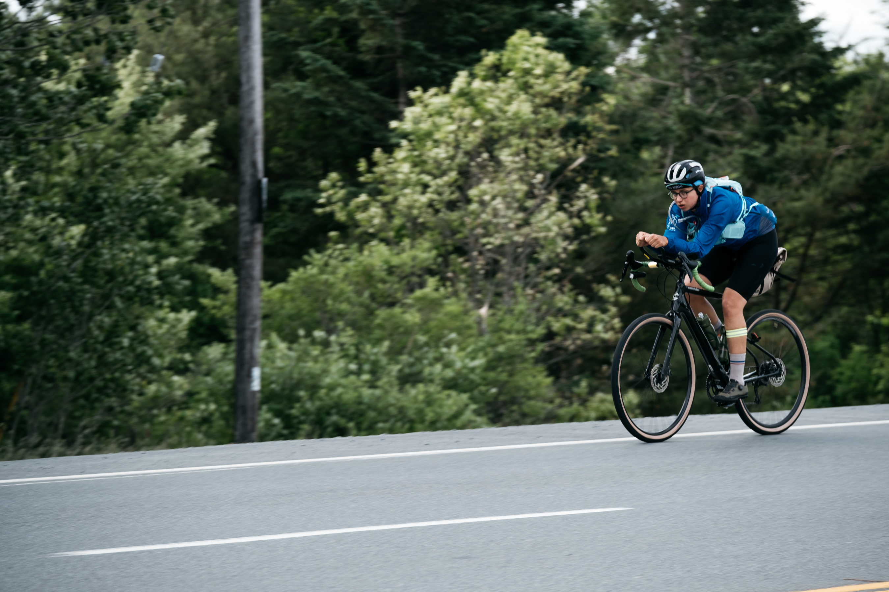
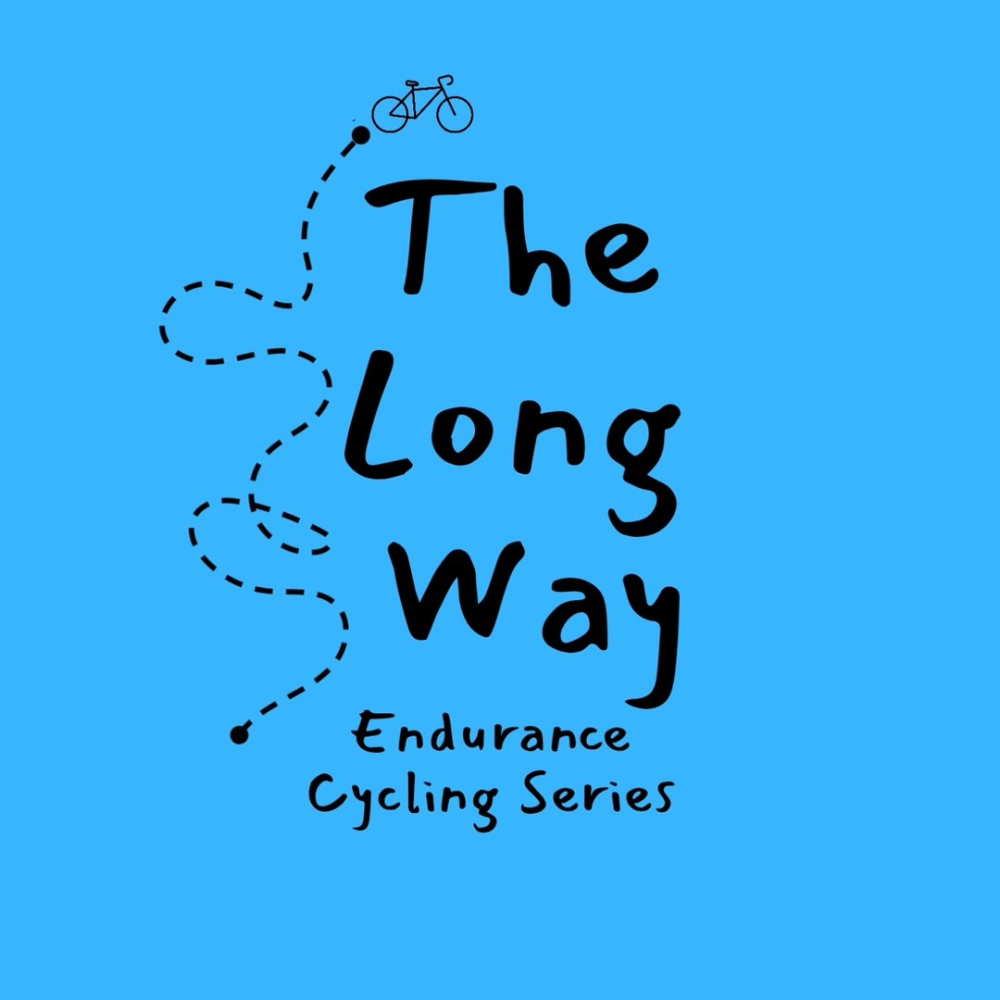
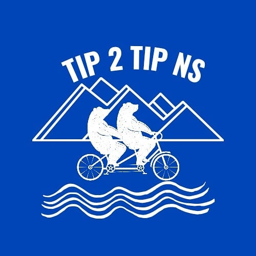
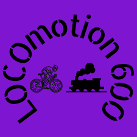

::: {.race-header}


<div class="about-hero-content">

<p class="about-tagline"></p>
</div>

:::

The Long Way Cycling Series is Nova Scotia’s homegrown long-distance cycling series, born from a simple idea: why travel halfway around the world for an adventure when there’s plenty to be found right here?

It all started back in 2020, when international races were off the calendar and ultra-endurance cycling events in Atlantic Canada were pretty much nonexistent. Three cyclists, soon to become friends, had the same, slightly unhinged idea: ride across Nova Scotia, Tip 2 Tip! From The Hawk Beach to Meat Cove, roughly 750 km from one end of the province to the other, with plenty of hills, headwinds, and questionable life choices along the way.

And somewhere along the way, an idea took hold: if we wanted this kind of adventure here, surely other people did too? And so <strong>The Long Way Cycling Series</strong> was born, and is today a series of self-supported endurance cycling events that take riders across Nova Scotia and beyond. Different distances, different routes, different ways to get there, but the main idea is still the same: get on your bike, go somewhere, and see what happens along the way.

```{=html}
<div class="race-cards">

  <a href="tip2tiprace.qmd" class="race-card">
    <div class="race-logo">
      
    </div>
    <div class="race-card-content">
      <div class="race-card-label">THE ORIGINAL</div>
      <h2>Tip 2 Tip Nova Scotia</h2>
      <p>Choose your route. Hit the checkpoints· Self-supported</p>
      <span class="race-card-link">Explore the original →</span>
    </div>
  </a>

  <a href="tip2tipgravel.qmd" class="race-card race-card-secret">
    <div class="race-logo race-logo-secret">
      <span>?</span>
    </div>
    <div class="race-card-content">
      <div class="race-card-label">COMING 2027</div>
      <h2>The Hodge Podge</h2>
      <p>Gravel · Point-to-point fixed route· Self-supported</p>
      <span class="race-card-link">Explore the race →</span>
    </div>
  </a>

  <a href="locomotion-600.qmd" class="race-card">
    <div class="race-logo">
      
    </div>
    <div class="race-card-content">
      <div class="race-card-label">THE 600</div>
      <h2>LOCOmotion 600</h2>
      <p>~650 km · Fixed route · Self-supported</p>
      <span class="race-card-link">Explore the ride →</span>
    </div>
  </a>

  <a href="noreaster-race.qmd" class="race-card race-card-secret">
    <div class="race-logo race-logo-secret">
      <span>?</span>
    </div>
    <div class="race-card-content">
      <div class="race-card-label">COMING 2028</div>
      <h2>The Nor'Easter</h2>
      <p>Montreal → Halifax · New challenge in development</p>
      <span class="race-card-link">See the early details →</span>
    </div>
  </a>
</div>
```

```{=html}
<section class="follow-us" aria-labelledby="follow-us-heading">
  
  <div class="follow-us-content">
    <h2 id="follow-us-heading">FOLLOW US</h2>
    <div class="follow-us-links">
    <a href="https://www.facebook.com/tip2tipns/">
      <i class="bi bi-facebook" aria-hidden="true"></i>
      <span>Facebook</span>
    </a>
    <a href="https://www.instagram.com/tip2tip_ns/">
      <i class="bi bi-instagram" aria-hidden="true"></i>
      <span>Instagram</span>
    </a>
    </div>
  </div>
</section>
```