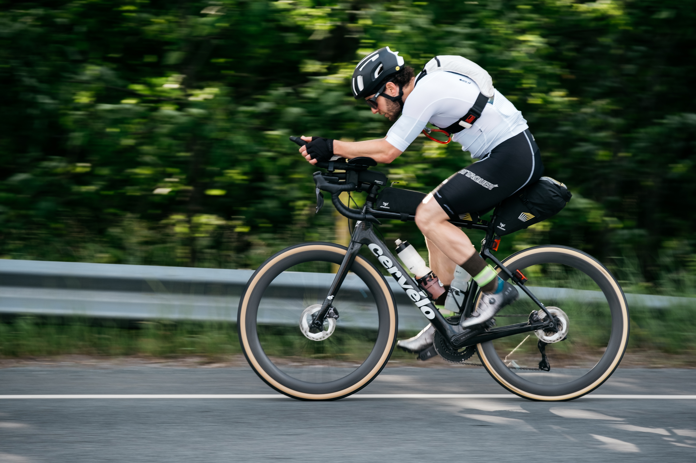
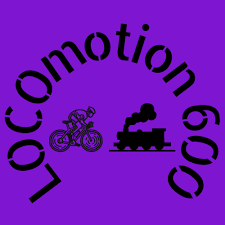
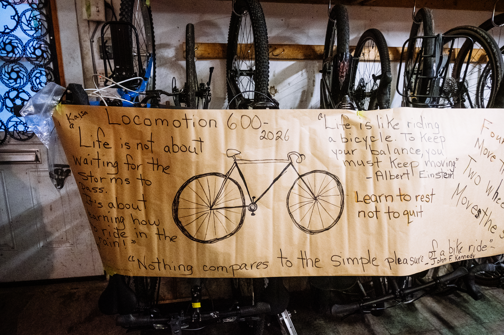

::: {.race-header .column-screen}


<div class="fkt-hero-content">


<h1>LOCOmotion 600</h1>

<div class="fkt-hero-stats">
<span><strong>600+</strong> KM</span>
<span><strong>60</strong> HOURS</span>
<span><strong>SELF-SUPPORTED</strong></span>
</div>

</div>

:::

The **LOCOmotion 600** is a roughly 600+ km fixed-route, single-stage, self-supported endurance ride starting and finishing in Halifax, Nova Scotia.

LOCOmotion has become a bit of **Nova Scotia cycling legend**. Every year, riders make their way through rural towns and communities across the province with loaded bikes, tired legs and questionable amounts of convenience-store food, occasionally raising a few eyebrows along the way.

It's challenging, but it's also designed to be approachable. The LOCOmotion is a great introduction to **self-supported endurance riding**: long enough to test your legs, planning and resilience, while keeping you relatively close to civilization and the next place to find food, water or somewhere to sleep.

You have **2.5 days to get yourself around the route and back to Halifax.**

## When?

**June 12–14, 2027.**

[Registration for all races opens in January/February 2027.](register.qmd)

::: {.race-formats .column-screen}
## Race Formats

Ride solo or as a pair. Either way, take on the full fixed route and make the ride your own.

::: {.race-format-grid}
::: {.race-format-card .race-format-full}
### SOLO

::: {.race-format-summary}
:::

Take on the LOCOmotion at your own pace, making the route, rest and resupply decisions yourself.
:::

::: {.race-format-card .race-format-pairs}
### PAIRS

::: {.race-format-summary}
:::

Ride as a pair, work together, and draft one another as you tackle the route.
:::
:::
:::

***
:::: {.race-route .column-screen}
::: {.race-route-map}
```{=html}
<iframe src="https://www.followmychallenge.com/live/locomotion26/" title="LOCOmotion 600 2026 past-edition tracking map" loading="lazy" allowfullscreen></iframe>
```

**Past edition: LOCOmotion 2026.** This is not the upcoming race course.
:::

::: {.race-route-text}
## The Route

The LOCOmotion follows a fixed route of approximately **650 km**, starting and finishing at the Halifax Citadel. Expect long days, changing weather, some gravel, a lot of Nova Scotia, and probably a few stories by the time you get back.


There are **three checkpoints** along the route. Checkpoint 2 is always volunteer-run and provides riders with a place to stop, rest and refuel.

Expect some gravel. **28 mm tires are considered the minimum width** for this event. Having said that, your bike, your choice. 

The route changes each year, is scouted each spring, and may undergo minor changes before the event. 
:::
::::

::: {.blue-section}
## Past Editions

Explore the tracking maps from previous editions of LOCOmotion 600.

- **2026** — [View the race tracking map](https://www.followmychallenge.com/live/locomotion26/).
- **2025** — [View the race tracking map](https://www.followmychallenge.com/live/locomotion25/).
- **2024** — [View the race tracking map](https://www.followmychallenge.com/live/locomotion24).
- **2023** — [View the race tracking map](https://www.followmychallenge.com/live/locomotion/).
- **2022** — [View the race tracking map](https://www.followmychallenge.com/live/locomotion600/).
:::

## The Riders Who Took the Long Way

Meet the riders from previous editions and explore their results.

[View LOCOmotion 600 alumni and results →](alumni-locomotion.qmd)\

::: {.folder-gallery data-folder="images/loco_gallery"}
:::


***
## THINKING ABOUT RIDING?

You don't need to have ridden hundreds of kilometres before, or even consider yourself an endurance cyclist, to take on the LOCOmotion 600. Maybe this is your first big cycling challenge, maybe you're curious about how far you can go, or maybe you're an experienced ultra-racer looking to push the pace. Whatever brings you to the start line, LOCOmotion is about giving it a go, figuring things out along the way and seeing what you're capable of.

There's no single right way to approach the LOCOmotion. Some riders will race each other, some the clock. Others will take a more measured approach, stopping for a proper meal or a few hours of sleep. Whatever your strategy, the challenge is the same: get yourself and your bike back to Halifax as fast as you can.

There will be moments when you wonder why you signed
up. Probably somewhere in the middle of the night,
on a hill that really didn't need to be there. But there will also be quiet roads at sunrise, unexpected
kindness in small towns, conversations with other riders
and the satisfaction of doing something you weren't
entirely sure you could do. And somehow by the end, the hardest parts have a way of becoming
the fondest memories. You might arrive back in Halifax exhausted, but
you'll leave with stories, new friends and maybe even a reason to do it all again next year.

***

```{=html}
<div class="loco-register">
  <div class="race-registration-logo">
    
  </div>
  <a href="register.qmd" class="race-registration-details">

  <h2>READY TO RIDE A LONG WAY?</h2>

  <p>
    Whether you're chasing a fast finish or taking on
    your first ultra, there's a place for you on the
    LOCOmotion start line.
  </p>

  <p>
    Find registration, entry fees, GPS tracking,
    insurance requirements, event rules and rider
    information on our registration page.
  </p>

  <span class="race-registration-arrow">
    REGISTRATION & RACE DETAILS →
  </span>
  </a>

</div>
```

::: {.race-header .column-screen}

:::

::: {.race-resources}
[Race Rules](rules.qmd) [FAQ](FAQ.qmd)
:::
