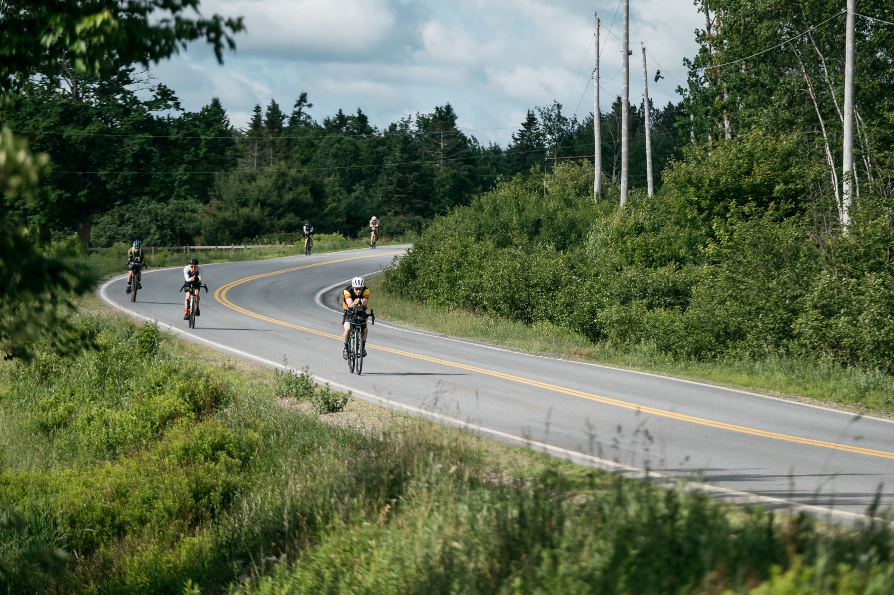

::: {.race-header}
{.hero-image-flipped}

<h1>The Nor'Easter</h1>

<strong>Montreal</strong> START
<strong>Halifax</strong> FINISH
<strong>Self-Supported</strong>

:::

## A NEW EASTBOUND CHALLENGE

The Nor'Easter, the next race in The Long Way series, is in development for **2028**.

The concept is simple: start in **Montreal**, finish in **Halifax**, and manage yourself the whole way.

This page is an early teaser, not a full race manual. Distances, checkpoints, rules, and registration details are still being finalized.

More details coming as route planning continues. Follow us on Instagram for updates and announcements as we finalize the route and race details.

## When?

**Planned for 2028.** Exact dates will be announced.

::: {.race-resources}
[Race Rules](rules.qmd) [FAQ](FAQ.qmd)
:::
