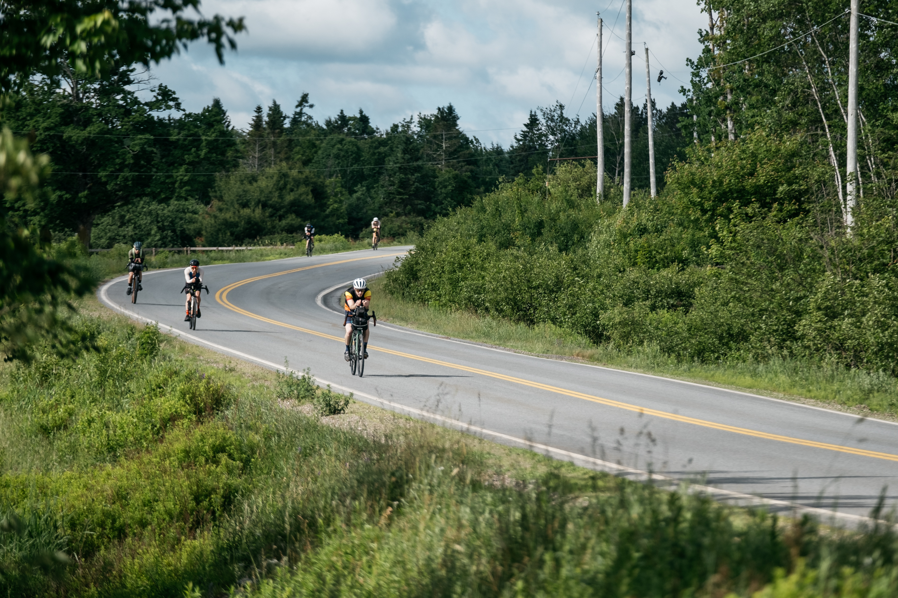
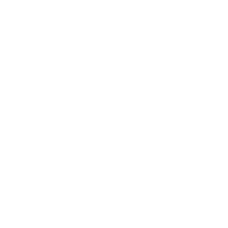
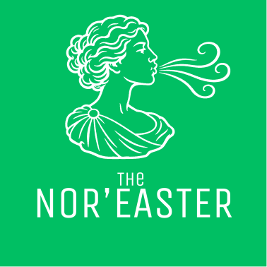

::: {.race-header}
{.hero-image-flipped}

<div class="fkt-hero-content">

<h1>The Nor'Easter</h1>
<div class="fkt-hero-stats">
<span><strong>Montreal</strong> START</span>
<span><strong>Halifax</strong> FINISH</span>
<span><strong>Self-Supported</strong></span>
</div>
</div>

:::

## A NEW EASTBOUND CHALLENGE

The Nor'Easter is in development for **2028**.

The concept is simple: start in **Montreal**, finish in **Halifax**, and manage yourself the whole way. More details coming as route planning continues. [Sign up for updates](register.qmd) or follow us on socials for future announcements as we finalize the route and race details.

## When?

**Planned for 2028.** Exact dates will be announced.


```{=html}
<div class="loco-register">
  <div class="race-registration-logo">
    
  </div>
  <a href="register.qmd" class="race-registration-details">

  <h2>READY TO RIDE A LONG WAY?</h2>

  <p>
    Registration for The Nor'Easter will open in early 2028.
  </p>

  <span class="race-registration-arrow">
    REGISTRATION & RACE DETAILS →
  </span>
  </a>

</div>
```


::: {.race-resources}
[Race Rules](rules.qmd) [FAQ](FAQ.qmd)
:::
