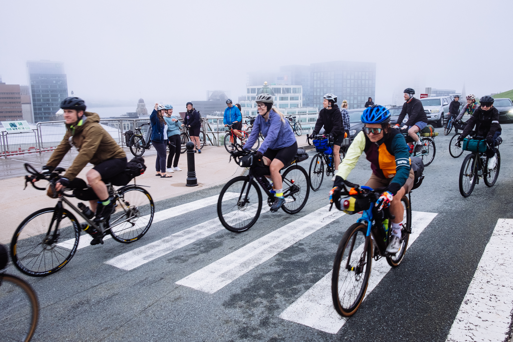
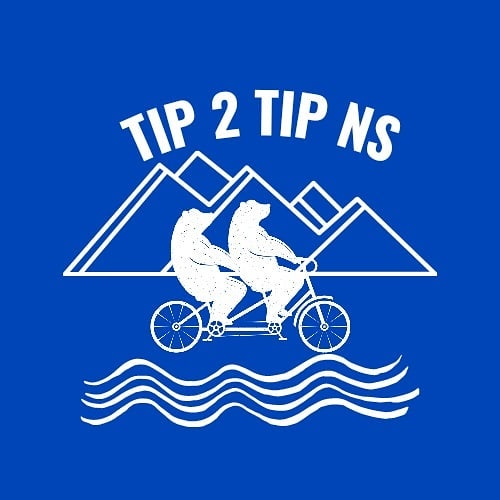
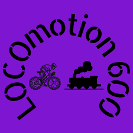

::: {.race-header .column-screen}

The Long Way

<h1>Registration</h1>

:::

::: {.registration-page}
## Ready to Ride a Long Way?

Race registration will go live when early-bird entries open.

We'll announce registration dates, entry fees and race details here ahead of each event. Check back for updates.

## Race Calendar

Plan your next long way with the race dates announced so far.

| Race | When? |
|:-----|:------|
| [LOCOmotion 600](locomotion-600.qmd) | **June 12–14** |
| [Tip 2 Tip](tip2tiprace.qmd) | **August** — exact dates to be announced |
| [The Hodge Podge](tip2tipgravel.qmd) | **Early October 2027** — exact dates to be announced |
| [The Nor'Easter](noreaster-race.qmd) | **Planned for 2028** — exact dates to be announced |

These are race dates, not registration opening dates. Entry opening dates will be announced separately.

## Explore the Races

<nav class="registration-races" aria-label="Explore the races">
  
  <a href="tip2tipgravel.qmd" class="registration-mystery">
    ?
    The Hodge Podge
  </a>
  
  <a href="noreaster-race.qmd" class="registration-mystery">
    ?
    The Nor'Easter
  </a>
</nav>

:::
