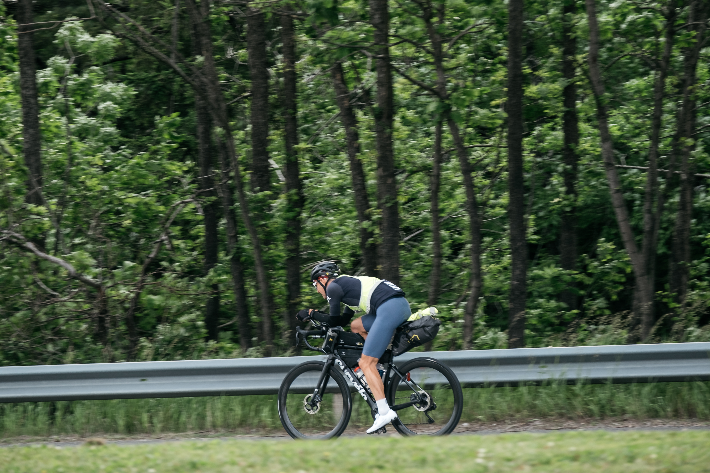

::: {.race-header .column-screen}

The Long Way

<h1>The Rules</h1>

:::

**No debating the rules.**

The Long Way Cycling Series events are self-supported rides. The rules are simple, and they're based on the honour system. Please follow them and respect the self-supported nature of the event.

***

## The Basics

* Any **pedal-powered bicycle** is acceptable.
* A **helmet must be worn at all times** while riding.
* Follow the **rules of the road**.
* **No drafting**, unless you are riding as a registered pair.
* Anything you bring with you at the start must make it back to the finish with you, excluding consumables.

***

## Riding as a Pair

Pairs may share resources and draft one another.

You must **finish together**. If one rider cannot finish, the pair will be recorded as a DNF.

***

## Self-Supported Means Self-Supported

* **No outside assistance of any kind.**
* Any service you use—food, accommodation, mechanical services, supplies, etc.—must be **commercially available to all riders**.
* Arranging to "meet" friends or family along the route is considered outside support.
* Accommodation cannot be booked before the ride begins.

**One exception:** Because of the relative remoteness of the Cape Breton portion of the route, riders may book accommodation in advance for the night they expect to complete the ride.

***

## Mechanical Problems

Mechanical problems happen.

If a mechanical issue cannot be resolved where it occurs, a rider may obtain a ride to access mechanical service. To continue the event, the rider must then be returned to **the same location where they left the route** and resume from there.

***

## Be Seen

You need to be visible—especially at night.

Light-coloured and reflective clothing is strongly recommended. **At night, you should light up like a Christmas tree.**

Riders are required to carry:

* **Two rear lights:** one flashing and one steady.
* **At least one front light** capable of adequately illuminating the road at night.
* At least **one rear light must be running at all times** while riding.
* **Ankle reflectors are highly recommended.**

***

## The Honour System

**These rules are based on the honour system.**

Please follow them, ride fairly, and uphold the self-supported nature of the Long Way Cycling Series.
