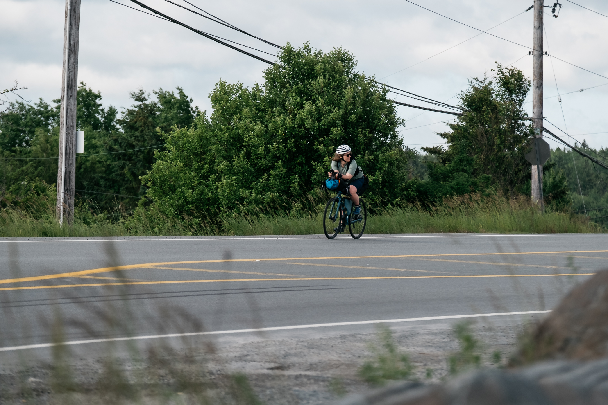

::: {.race-header}

NOVA SCOTIA

<h1>TIP 2 TIP!</h1>

<strong>750</strong> KM
<strong>7,000+</strong> M
<strong>SOUTH → NORTH</strong>

:::

<section class="records">

<h2>Current Record Holders</h2>

SELF-SUPPORTED

FEMALE

Ashleigh Myles

44h 22m 55s

September 23, 2023

MALE

Matthieu Fraser

45h 25m 59s

August 29, 2020

NON-BINARY

—

No record yet

&nbsp;

SUPPORTED

FEMALE

—

No record yet

&nbsp;

MALE

—

No record yet

&nbsp;

NON-BINARY

—

No record yet

&nbsp;

</section>

***

## The Route

This FKT is based on the **honour system and GPS data**. It follows a direct route from **The Hawk Beach to the Meat Cove Campground sign**. You can access the gpx file [here](https://ridewithgps.com/routes/45821226).

All riders must travel **south to north** for this FKT.

The route is approximately **750 km**. To account for GPS errors, a **minimum distance of 747 km** will be accepted. There is no cap on a longer route; however, it is in your best interest not to deviate too far from the original route.

**Elevation:** 7,000+ m

Previous attempts have recorded 7,270 m and 7,011 m of elevation gain. Differences are expected due to GPS error, construction detours, and resupply stops.

***

## FKT Categories

There are two ways to attempt the Tip 2 Tip FKT: **self-supported** or **supported**.

There is a **HUGE difference** between the two. Whichever category you choose, you must follow it for the entire ride.

If you're unclear about what counts as self-supported or supported, don't hesitate to reach out with questions before your attempt.

#### Self-Supported

Do it all yourself!

There is **no outside assistance**. No support vehicles or people meeting you along the way. Get from A to B carrying your own gear and using services that are equally available to everyone.

No drafting behind another rider or vehicle.

#### Supported

A support vehicle and other outside assistance are allowed. Food, water, and supply drops are all OK.

You **cannot draft** behind the support vehicle or another rider.

***

::: {.brown-section}
## Rules for an FKT Effort

* **Minimum distance is 747 km.** Any detour must be the same length as, or longer than, the original route.

* **The ride must be recorded in full.** Use a GPS device to record your route, distance, total time, and speed. Manually uploaded statistics are not accepted—you need a recording of your track. If you're unsure whether your GPS device can be used, reach out before your attempt.

* **The clock never stops!** Elapsed time is used for the FKT, not moving/ride time.

* **Resupply deviations are OK.** Return to the route at the same point. If this isn't possible because of construction or another closure, take a detour that is the same length as, or longer than, the original route.

* **Use the same bike for the entire ride.**

* **Follow the rules of the road** and respect other road users.

* **Wear a helmet at all times.** Reflective clothing and equipment are highly recommended. You'll be riding on busy highways for almost the entire route.
:::

***

## Safety

Every rider takes on risk when attempting this FKT. **Be safe. Be smart.**

Insurance through [Cycling Nova Scotia](https://cyclingns.ca/insurance/) is highly recommended in case an injury or accident occurs.

The Tip 2 Tip FKT is **not a sanctioned event**. It is an individual undertaking that can be attempted at any time of year and is open to anyone.

***

## Planning an Attempt?

Please let the organizers of **Tip 2 Tip NS** know about your intention to ride **at least two weeks before starting**.

Take some photos, challenge yourself, and have fun!
