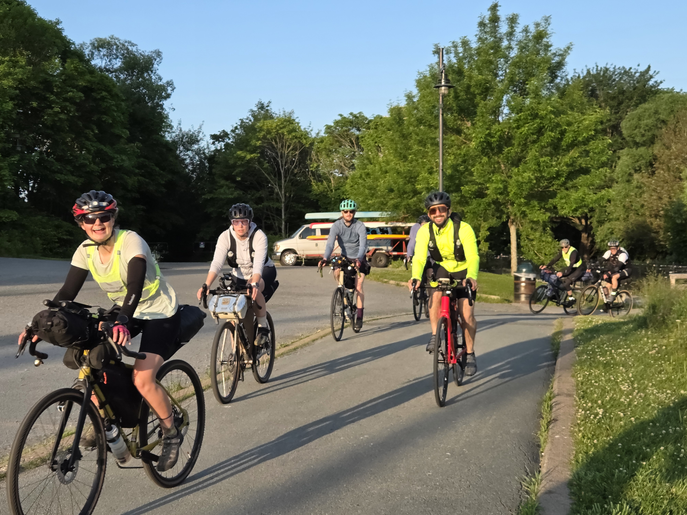
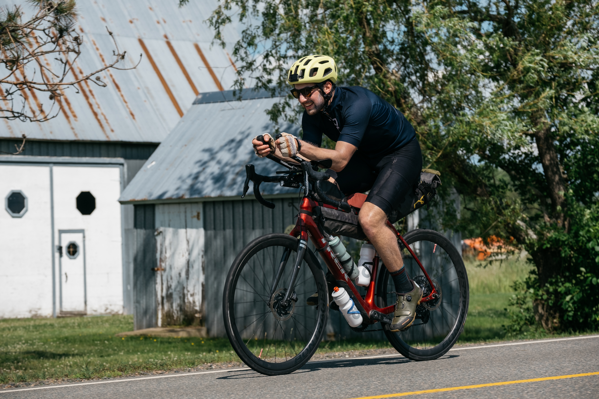

::: {.race-header .column-screen}


<div class="fkt-hero-content">
<div class="fkt-kicker">COMING 2027</div>
<h1>The Hodge Podge</h1>
</div>
:::

```{=html}
<div class="tip2tip-offroad column-screen">
  <section class="offroad-story">
    <div class="offroad-story-text">
      <h2>Tip 2 Tip, but off the pavement!</h2>
      <p>From one end of Nova Scotia to the other. But this time, it's a gravel adventure!</p>
      <p>If you're from the Maritimes, you probably know Hodge Podge. A traditional summer dish made with fresh vegetables, cream, butter, and whatever's in season. It's simple, hearty, and a little bit of everything thrown together. And we thought that sounded like a pretty good way to describe a gravel race across Nova Scotia.</p>
      <p>In 2027, we're taking Tip 2 Tip off the pavement. The Hodge Podge is the gravel edition of Tip 2 Tip, taking riders across the province from one end to the other on a fixed route that mixes gravel roads, backroads, ATV trails, and everything in between.</p>
    </div>
    <div class="offroad-story-image">
      
    </div>
  </section>

  <section class="offroad-story offroad-story-reverse">
    <div class="offroad-story-text">
      <h2>What to expect?</h2>
      <p>In The Hodge Podge, expect around 70% off-road, remote stretches, rough terrain, and a few well-placed checkpoints to resupply, where riders will have a chance to refuel and rest in some out-of-the-way places without losing the spirit of self-sufficiency.</p>
      <p>Ever heard of the Darién Gap in Nova Scotia? No? Well, you're going to ride through it. Throw in the Pipeline out of the city, bear country, a few river crossings, forgotten tracks, and some of the wilder corners of the province, and you've got a pretty good idea of what you're signing up for. And rail trails? We avoid those at all costs!</p>
      <p>In true Hodge Podge fashion, it's a bit of everything thrown together. Some sections will be fast and fun, others might have you questioning your life choices, but put it all together and you've got something pretty special. Coming 2027!</p>
      <p><strong>THE ROUTE REVEAL IS COMING. FOLLOW US ON INSTAGRAM FOR UPDATES!</strong></p>
    </div>
    <div class="offroad-story-image">
      
    </div>
  </section>
</div>
```

***

::: {.race-formats}
## When?

**Early October 2027.** Exact dates will be announced.

**Always be prepared.** Nova Scotia's coastal weather can turn cold, wet and windy, even in summer. Hypothermia is a risk at any time of year. Carry warm layers and waterproof gear, check the forecast, and be ready for changing conditions.

## Race Formats

There are two ways to take on The Hodge Podge. Go the full distance or share the adventure with a team.

::: {.race-format-grid}
::: {.race-format-card}
### Full Distance — Solo or Pairs

Take on the entire Hodge Podge route from start to finish. Ride solo or as a pair, tackling every kilometre, climb, and whatever else Nova Scotia throws your way.
:::

::: {.race-format-card}
### Relay — Team Edition

Want to share the Hodge Podge? Gather a team and split the route however you like.

Riders can switch at designated checkpoints along the course. Take on one section, two, or as many as you want. There's no set distance each rider needs to cover, but all rider changes must happen at official checkpoints. The active rider must reach the checkpoint before handing over to the next team member.

How you divide the distance is up to your team. Just make sure someone is always ready for the next serving!
:::
:::
:::

***

```{=html}
<div class="loco-register">
  <div class="race-registration-logo registration-mystery">
    <span aria-hidden="true">?</span>
    <span class="race-card-label">The Hodge Podge</span>
  </div>
  <a href="register.qmd" class="race-registration-details">

  <h2>READY TO RIDE A LONG WAY?</h2>

  <p>
    Take on the full Hodge Podge solo or as a pair,
    or share the adventure with a relay team.
  </p>

  <p>
    Find registration, entry fees, GPS tracking,
    insurance requirements, event rules and rider
    information on our registration page.
  </p>

  <span class="race-registration-arrow">
    REGISTRATION & RACE DETAILS →
  </span>
  </a>

</div>
```

::: {.race-resources}
[Race Rules](rules.qmd) [FAQ](FAQ.qmd)
:::