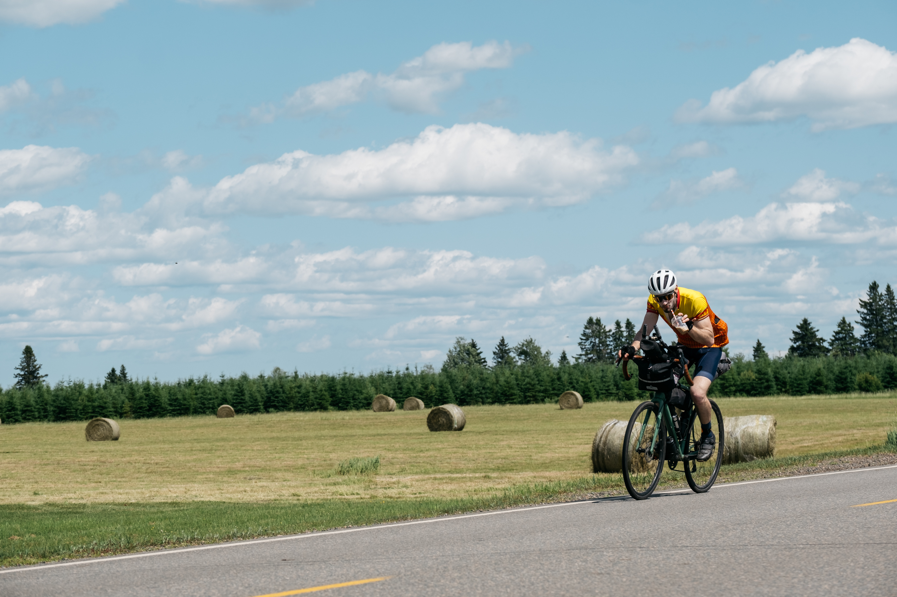

::: {.race-header .column-screen}

The Long Way

<h1>Tip 2 Tip</h1>

<strong>1,000–1,200</strong> KM
<strong>5</strong> DAYS
<strong>SELF-SUPPORTED</strong>

:::

  <h2>THE ORIGINAL</h2>

  

    Start at <strong>The Hawk Beach</strong>, with the Atlantic
    behind you. Finish at <strong>Meat Cove</strong>, about
    1,000–1,200 km of Nova Scotia later. What happens in
    between is largely up to you.
  

  

    There is no prescribed route. Riders are given a series
    of checkpoints scattered across the province and choose
    how to connect them. The shortest route isn't always the
    fastest, and the best idea at noon can look considerably
    worse at 2 a.m.
  

  

    Ride solo or as a pair. Carry what you need. Find food,
    water and somewhere to sleep along the way. No support
    vehicles. No private supply drops. Just you, your bike,
    five days and a very long way north.
  

  

    Tip 2 Tip grew from a few friends riding end-to-end in
    2020 to its first race in 2021. Since then, each edition
    has taken riders on a different journey across Nova Scotia.
  

::: {.race-resources}
[Race Rules](rules.qmd) [FAQ](FAQ.qmd)
:::
