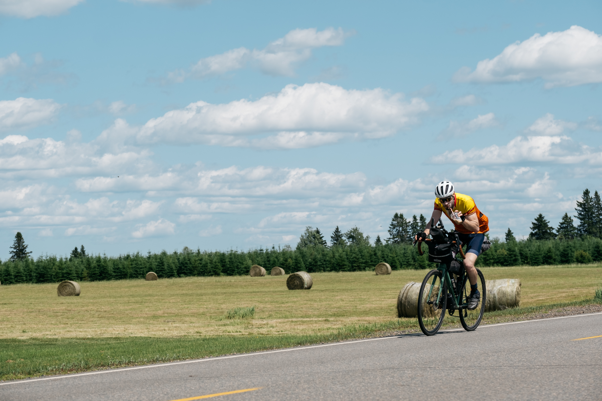
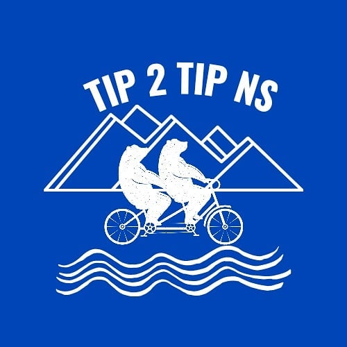

::: {.race-header}


<div class="fkt-hero-content">
<div class="fkt-kicker">The Long Way</div>
<h1>Tip 2 Tip</h1>
<div class="fkt-hero-stats">
<span><strong>1,000–1,200</strong> KM</span>
<span><strong>5</strong> DAYS</span>
<span><strong>SELF-SUPPORTED</strong></span>
</div>
</div>

:::

  <p>
    Start at <strong>The Hawk Beach</strong>, with the Atlantic
    behind you. Finish at <strong>Meat Cove</strong>, about
    1,000–1,200 km of Nova Scotia later. What happens in
    between is largely up to you.
  </p>

  <p>
    There is no prescribed route. Riders are given a series
    of checkpoints scattered across the province and choose
    how to connect them. The shortest route isn't always the
    fastest, and the best idea at noon can look considerably
    worse at 2 a.m.
  </p>

  <p>
    Ride solo or as a pair. Carry what you need. Find food,
    water and somewhere to sleep along the way. No support
    vehicles. No private supply drops. Just you, your bike,
    five days and a very long way north.
  </p>

  <p>
    Tip 2 Tip grew from a few friends riding end-to-end in
    2020 to its first race in 2021. Since then, each edition
    has taken riders on a different journey across Nova Scotia.

  </p>

***

## When?

**August.** Exact dates will be announced.

**Always be prepared.** Nova Scotia's coastal weather can turn cold, wet and windy, even in summer. Hypothermia is a risk at any time of year. Carry warm layers and waterproof gear, check the forecast, and be ready for changing conditions.

## Past Editions

Different checkpoints, different adventures. Explore the past editions and see how the race has evolved.

- **2026 — No race.** Organiser Ashleigh Myles was busy setting the FKT and World Record for the Pan American Highway, Alaska to Argentina!
- **2025 — Oops! All the Tips Edition.** August 2–7. [View the race tracker](https://www.followmychallenge.com/live/tip2tipns25/).
- **2024** — August 24–29. [View the race tracker](https://www.followmychallenge.com/live/tip2tipns24/).
- **2023** — [View the race tracker](https://www.followmychallenge.com/live/tip2tipns23/).
- **2022** — [View the race tracker](https://www.followmychallenge.com/live/tip2tipns22/).
- **2021** — August 27 – September 1.

### The Riders Who Took the Long Way

Meet the riders from previous editions and explore their results.

[View Tip 2 Tip alumni and results →](alumni.qmd)

***

```{=html}
<div class="loco-register">
  <div class="race-registration-logo">
    
  </div>
  <a href="register.qmd" class="race-registration-details">

  <h2>READY TO RIDE A LONG WAY?</h2>

  <p>
    Choose your route, connect the checkpoints and make
    your own way across Nova Scotia on the original Tip 2 Tip.
  </p>

  <p>
    Find registration, entry fees, GPS tracking,
    insurance requirements, event rules and rider
    information on our registration page.
  </p>

  <span class="race-registration-arrow">
    REGISTRATION & RACE DETAILS →
  </span>
  </a>

</div>
```

::: {.race-resources}
[Race Rules](rules.qmd) [FAQ](FAQ.qmd)
:::
